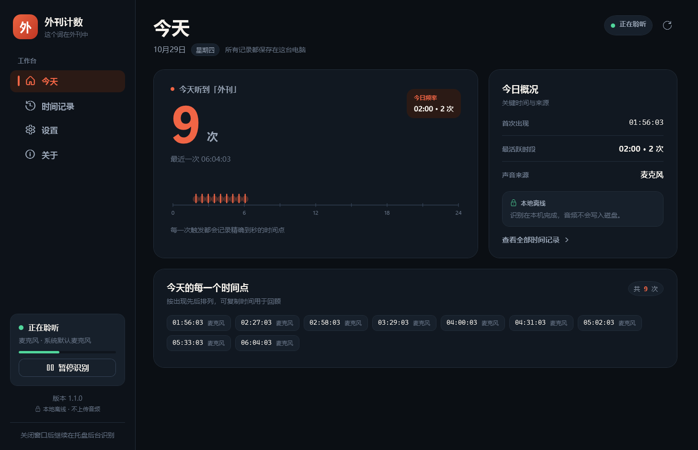
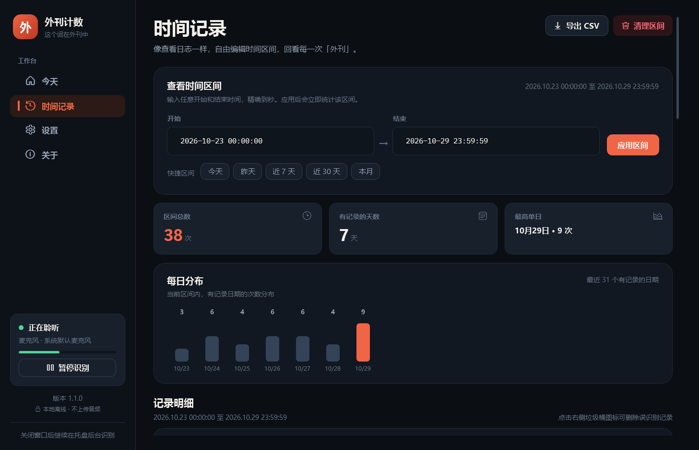
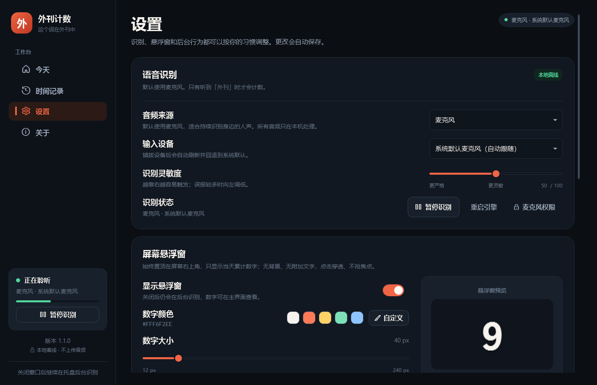
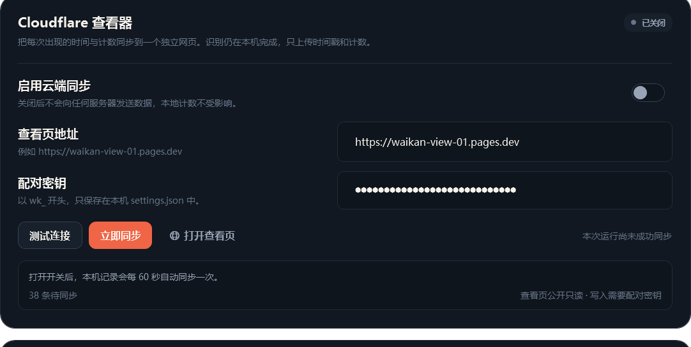
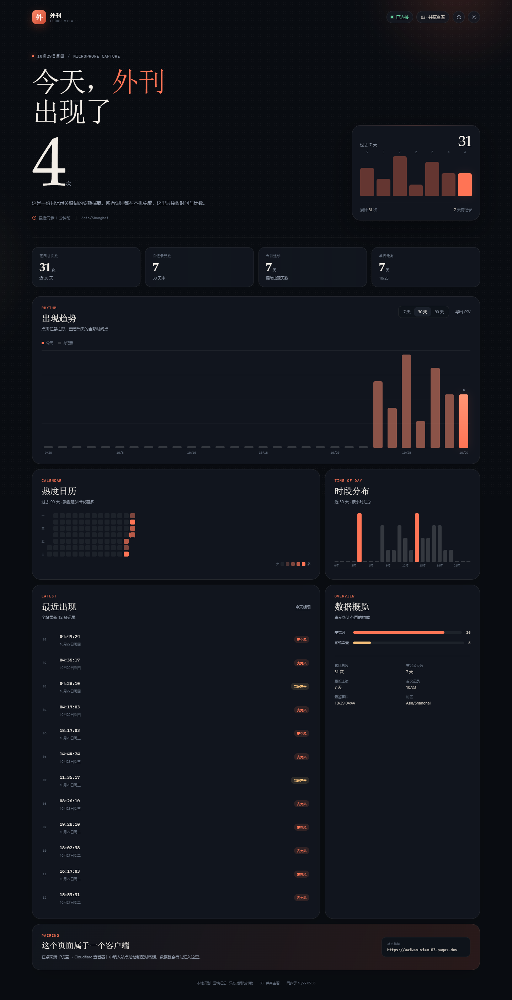
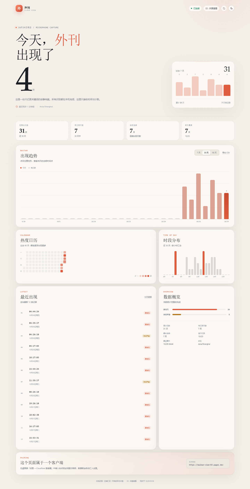

# 这个词在外刊中

[](https://github.com/B5-Software/waikan/actions/workflows/ci.yml)
[](LICENSE)


一个原生 Windows 桌面应用：在麦克风里听到「外刊」时自动记下一次，统计每天出现的次数，并把每一次出现的时间点保留下来。

识别过程完全在本机完成。不上传音频，不保存录音。云端同步是可选功能：如果启用，只会把时间戳、来源和计数推送到你自己的 Cloudflare Pages 查看页。



## 下载与安装

推荐使用 NSIS 安装器：

```text
Waikan-1.1.0-x64-setup.exe
```

安装器会：

- 安装到当前用户目录 `%LOCALAPPDATA%\Programs\Waikan`，不需要管理员权限；
- 创建开始菜单快捷方式；
- 写入当前用户的开机启动项（可在应用设置中关闭）；
- 提供标准卸载程序，卸载时可选择是否同时删除本地识别记录。

也可以在 Releases 下载便携版 `Waikan-win-x64-1.1.0.zip`，解压后直接运行 `Waikan.exe`。便携版首次运行时同样会按应用默认设置启用开机自启。

## 功能

- **常驻麦克风识别**：默认使用麦克风，基于 sherpa-onnx 的流式关键词检测，只监听「外刊」。
- **每日计数**：跨日自动归零，界面和桌面悬浮窗同步显示今日次数。
- **完整时间点**：每一次出现都保存到本地 SQLite；今日时间轴、时间点列表、历史记录都能回看。
- **自由时间区间**：在「时间记录」页输入任意开始/结束时间，精确到秒；也提供今天、昨天、近 7 天、近 30 天、本月快捷区间。
- **可编辑记录**：误识别可以单条删除，也可以清理一个时间区间；支持导出 CSV。
- **Fluent 风格界面**：深浅色主题跟随 Windows，也支持手动切换。
- **极简桌面悬浮窗**：置顶在屏幕右上角，只显示当天数字；无背景、无附加文字。数字颜色可调，字号范围 12–240 px，点击穿透、不抢焦点。
- **任务栏托盘**：左键打开主界面；右键菜单可切换悬浮窗、暂停识别、开机自启或退出。
- **开机后台自启**：安装器默认启用，登录 Windows 后在托盘后台识别，不弹主窗口。
- **低占用**：3M int8 关键词模型，单线程 CPU 推理；暂停时释放音频采集和识别会话。
- **可选 Cloudflare 查看页**：每个客户端一个独立的 Cloudflare Pages 站点和配对密钥；只同步时间戳、来源与计数，查看页公开只读，写入需要密钥。
- **默认离线 & 隐私**：不启用云端同步时没有任何网络请求；模型、数据库和日志都在本机。

## 快速开始

1. 运行安装器或直接双击 `Waikan.exe`。
2. 在 Windows「设置 → 隐私和安全性 → 麦克风」中允许桌面应用访问麦克风。
3. 在「设置 → 语音识别」中选择输入设备。默认使用“系统默认麦克风（自动跟随）”。
4. 正常说话即可。第一次听到「外刊」后，悬浮窗和「今天」页会更新。
5. 关闭主窗口会缩到系统托盘继续识别；右键托盘图标可以退出。

如果使用 ToDesk/向日葵等远程桌面，请启用远程麦克风转发，或在应用中选择对应的虚拟麦克风设备。

### 使用提示

- 环境噪音大、出现误识别时，把“识别灵敏度”向左调。
- 经常漏识别时，向右调高灵敏度。
- 修改音频来源、设备或灵敏度后，识别引擎会自动重启，通常几百毫秒恢复。
- 悬浮窗固定显示在**主屏幕**工作区右上角，避开任务栏。
- 识别到词的瞬间到界面更新通常有 0.5–1 秒延迟；记录时间已经做了声学延迟校准。

## 界面

| 时间记录 | 设置 |
| --- | --- |
|  |  |

深色和浅色主题：

| 深色 | 浅色 |
| --- | --- |
|  |  |

悬浮窗只显示数字本身：


## Cloudflare 查看页（可选）

桌面端可以把每次出现的时间点同步到一个独立的 Cloudflare Pages 站点。一个配对包含一个 Pages 站点、一个 KV 命名空间和一个客户端密钥，不同客户端的数据完全隔离。

桌面端配对设置：



- 默认关闭；在「设置 → Cloudflare 查看器」中填入站点地址和配对密钥后才会联网。
- 查看页公开只读，任何拿到链接的人都能看到计数与时间点，请不要把链接当作私密空间。
- 写入接口使用每个配对独立的 Bearer 密钥；服务端只保存密钥的 SHA-256，原始密钥以明文保存在本机 `settings.json`（以及部署机的 `cloudflare/pairs.local.json`）中，请不要分享这些文件。
- 只上传事件 ID、时间、本地日期、小时和来源（麦克风/系统声音），不上传音频、文本或设备信息。
- 桌面端每 60 秒自动同步一次；识别到新词后约 5 秒会触发一次。失败会自动重试，重复事件在服务端按事件 ID 幂等去重。
- 已同步的记录在本地删除后，云端不会自动删除；云端是一份只增的计数档案。
- 部署与配对方法见 [cloudflare/README.md](cloudflare/README.md)。

云端的深浅色主题：

| 深色 | 浅色 |
| --- | --- |
|  |  |

## 时间区间

「时间记录」页可编辑两个完整时间字符串：

```text
开始：2026-10-16 00:00:00
结束：2026-10-22 23:59:59
```

支持 `yyyy-MM-dd HH:mm[:ss]`、`yyyy/M/d HH:mm[:ss]`、`yyyy.MM.dd HH:mm[:ss]` 等常见格式。点击“应用区间”后立即统计。区间总次数、有记录天数、最高单日、每日分布和逐条明细都会同步更新。

结束时间是包含整秒的。例如 `23:59:59` 会包含该秒内的记录。CSV 导出包含：序号、日期、时间、关键词、来源、UTC 时间，使用 UTF-8 BOM，Excel 可以直接打开。

## 数据和文件位置

用户数据默认位于：

```text
%LOCALAPPDATA%\Waikan\
├─ waikan.db                 本地 SQLite 数据库
├─ settings.json             设置
├─ keywords.txt              当前关键词音素文件
└─ logs\app-YYYYMMDD.log     运行日志（自动清理 14 天前）
```

安装目录：

```text
%LOCALAPPDATA%\Programs\Waikan\
├─ Waikan.exe
├─ models\kws\               本地关键词模型（int8）
├─ runtimes\win-x64\native\  sherpa-onnx / onnxruntime / SQLite 原生库
├─ README.md
├─ LICENSE
├─ THIRD-PARTY-NOTICES.md
└─ licenses\
```

应用没有安装服务，没有写系统目录。用户数据与安装目录分离，升级或重新安装不会删除历史记录。

卸载：Windows 设置 → 应用 → 这个词在外刊中 → 卸载；也可以使用开始菜单中的卸载快捷方式。

## 资源占用与识别方案

- 引擎：**sherpa-onnx 1.13.8**，中文/英文双语 3M 关键词模型，`chunk-16` int8，CPU，单线程。
- 不是跑一整天的大模型全文转写；它只解码「外刊」这一条关键词路径，延迟低、CPU 占用小。
- 推理采用流式 KWS，约 320 ms 声学窗口；只有命中才产生一次数据库写入。
- 暂停识别会完全释放音频采集和 KWS 会话，不占麦克风。
- 应用是 .NET 10 WPF，不是 Electron。主窗口按需创建，开机后台实例不加载仪表盘。
- 实测后台暂停约 137 MB 工作集（私有内存约 73 MB），打开主界面约 202 MB；加载 KWS 后略有上浮。
- 模型基准 RTF 约 0.015（5.7 秒音频约 87 ms 模型解码，不含模型加载）。

## 构建与开发

### 前置条件

- Windows 10/11 x64
- .NET SDK 10.0.4xx
- NSIS 3（生成安装器时需要；可用 `winget install NSIS.NSIS`）
- 模型文件在 `models\kws`；如果缺失，构建脚本会自动调用 `scripts/fetch-model.ps1` 下载。

模型二进制不提交到 Git，避免仓库膨胀；CI 和本地构建都会自动下载。

### 构建

```powershell
# 构建、测试、发布、生成 zip 和 NSIS 安装器
.\scripts\build.ps1

# 指定本地 SDK
.\scripts\build.ps1 -Dotnet D:\dotnet-sdk\dotnet.exe

# 只构建便携版，不生成安装器
.\scripts\build.ps1 -SkipInstaller
```

产物：

```text
dist\Waikan-win-x64\Waikan.exe
dist\Waikan-win-x64-1.1.0.zip
dist\Waikan-1.1.0-x64-setup.exe
dist\*.sha256.txt
```

### CI

`.github/workflows/ci.yml` 在 Windows GitHub runner 上：

1. 检出源码；
2. 安装 .NET 10 SDK；
3. 确保 NSIS 可用；
4. 自动下载关键词模型；
5. 构建并执行测试；
6. 生成自包含便携版、zip 和 NSIS 安装器；
7. 上传构建产物；
8. 如果推送 `v*` 标签，自动创建 GitHub Release 并附加安装器与便携包。

### 测试

当前 38 个测试覆盖：

- 关键词模型真实推理（16 kHz 合成语音正/负样本）
- SQLite 初始化、插入、区间查询、日统计、并发写入、单条/区间删除
- SQLite v1 → v2 迁移、同步 ID 生成、待同步队列与标记
- Cloudflare 同步请求、Bearer 密钥、事件批处理、401 不误标记
- 设置序列化、损坏设置回退、参数归一化
- 时间区间解析、结束时间包含整秒
- 颜色解析、关键词文件生成、开机自启命令构造
- 48 kHz / 44.1 kHz 立体声下混与 16 kHz 重采样
- 深浅色主题资源替换
- Windows 音频访问拒绝异常识别

```text
38 passed, 0 failed
```

界面截图由 `tools/UiPreview` 在离屏 WPF 渲染中生成；不是合成示意图。

### 目录结构

```text
src/Waikan/
  Services/       音频采集、KWS、协调器、SQLite、设置、托盘、悬浮窗、单实例
  ViewModels/     主界面状态、时间区间、今日卡片
  Views/          今天、记录、设置、关于
  Themes/         深/浅色资源与 Fluent 风格控件
  Controls/       24 小时时间轴自定义绘制
  Interop/        DWM / 窗口样式 / 置顶
tests/Waikan.Tests/
cloudflare/       Cloudflare Pages 查看页、Functions 与配对部署脚本
scripts/          build.ps1、build-installer.ps1、installer.nsi、fetch-model.ps1
tools/KwsProbe/   模型音素与阈值调试工具
tools/UiPreview/  离屏界面截图工具
.github/workflows/ci.yml
```

## 故障排查

**识别状态显示“正在打开麦克风…”或超时**

- 检查麦克风是否被会议软件独占。
- 在 Windows 隐私设置中允许桌面应用访问麦克风。
- 更换输入设备，或点“重启引擎”。
- 音频驱动异常时，应用会在 9 秒后显示错误，而不是卡死界面。

**识别状态显示“Windows 拒绝了麦克风访问”**

这是一个明确的系统错误：

```text
0x80070005 E_ACCESSDENIED
```

表示 Windows 拒绝应用打开音频设备，不是模型或程序崩溃。应用已经检测到这种错误时会停止无效自动重试，并提示处理。建议：

- 打开“设置 → 隐私和安全性 → 麦克风”，确认“麦克风访问”和“让应用访问麦克风”已开启；
- 在“声音设置 → 输入”里确认麦克风没有被禁用、没有被其他软件独占；
- 使用 ToDesk/向日葵等远程桌面时，启用远程麦克风转发，或改用对应的虚拟麦克风；
- 处理完后点设置页的“重启引擎”，或重启应用。

**显示“正在聆听”但没有计数**

- 确认当前输入设备是正在使用的麦克风。
- 说话时看侧栏音量条是否跳动。
- 适当提高灵敏度；确认说的是“外刊”（wài kān）。
- 关键词检测不提供全文转写，因此无法在界面上核对上下文。

**悬浮窗被挡住**

- 独占全屏游戏会覆盖任何普通置顶窗口，可改用无边框窗口模式。
- 悬浮窗是点击穿透的；要调整颜色和字号，请到设置页。

**开机自启没有生效**

- 在「设置 → 启动与后台」确认开关处于开启状态。
- 某些安全软件会拦截 `HKCU\Software\Microsoft\Windows\CurrentVersion\Run\Waikan`。
- 移动便携版文件夹后重新打开一次应用，启动项路径会自动更新；安装版建议通过安装器升级。

## 已知限制

- 只识别单个关键词「外刊」，不做全文转写，也不保存音频。
- 关键词检测依赖发音和声学环境；极快语速、强噪声或方言口音可能需要调整灵敏度。
- 检测时间戳按声学延迟做了约 450 ms 校准；不宣称毫秒级精确。
- 悬浮窗使用普通 Topmost 窗口，无法覆盖独占全屏。
- 安装器/便携版可执行文件未签名，首次运行可能触发 Windows SmartScreen。
- 云端查看页是公开只读的；链接泄露即计数与时间点泄露。写入密钥只保护写入，不保护读取。
- 云端记录目前只增不删；删除本地记录不会删除已同步的云端数据。

## 开源、隐私与许可

- 源码：<https://github.com/B5-Software/waikan>
- 默认运行时无网络访问，不保存音频，不上传文本；只有主动启用 Cloudflare 同步后才会发送时间戳与计数。
- 本项目的原创源代码与文档以 **CC0 1.0 Universal** 献入公有领域，详见 [LICENSE](LICENSE)。
- 第三方组件和模型不适用 CC0：
  - 关键词模型来自 [sherpa-onnx](https://github.com/k2-fsa/sherpa-onnx)，Apache-2.0；
  - sherpa-onnx / onnxruntime：Apache-2.0；
  - NAudio：MIT；
  - .NET / Windows Desktop Runtime：MIT；
  - SQLite：public domain；SQLitePCLRaw：Apache-2.0。
- 完整许可见 [THIRD-PARTY-NOTICES.md](THIRD-PARTY-NOTICES.md) 和 `licenses/`。
